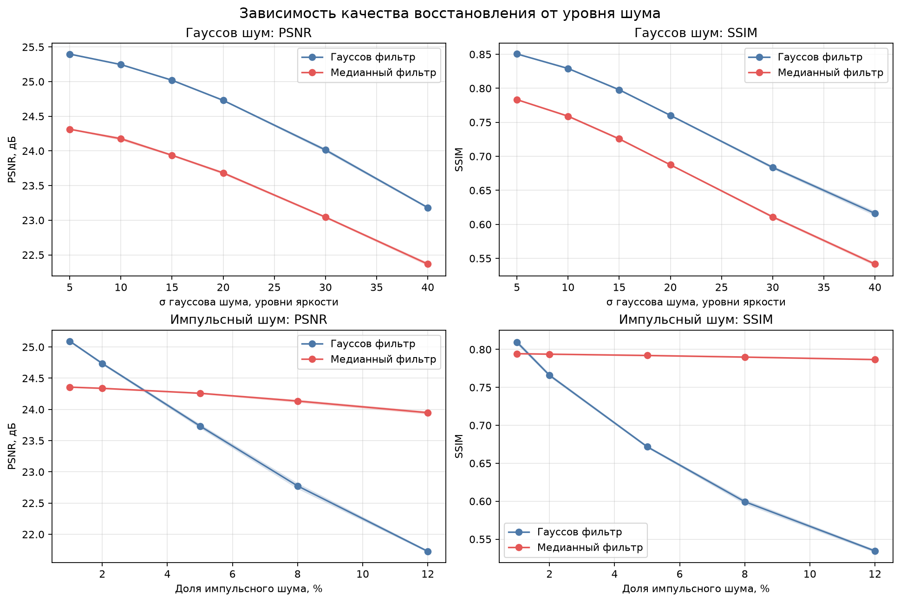
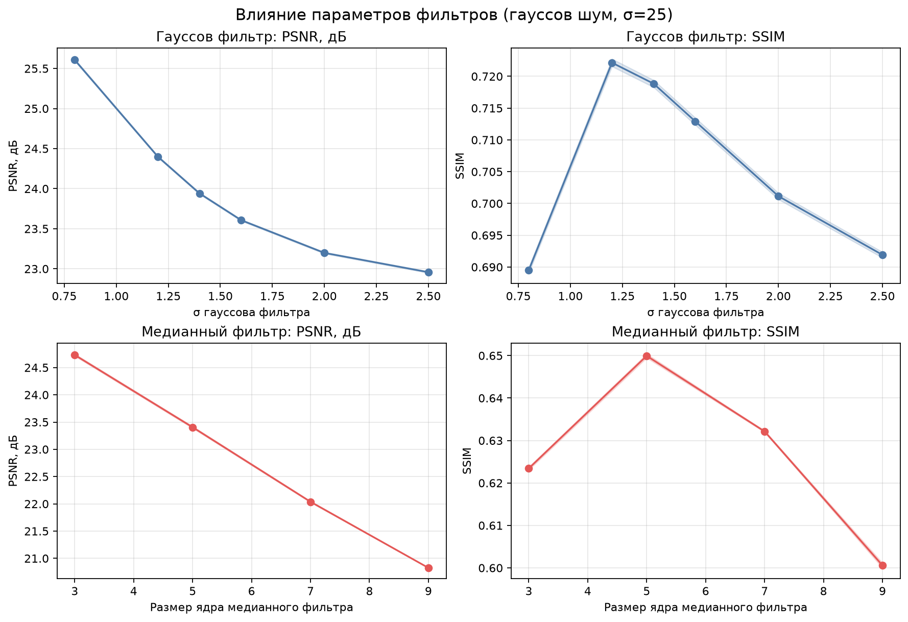
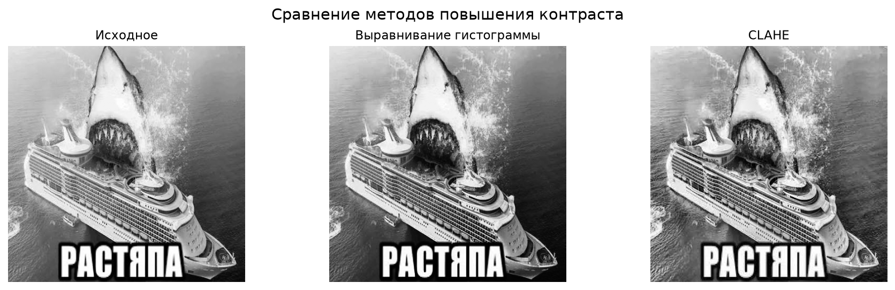
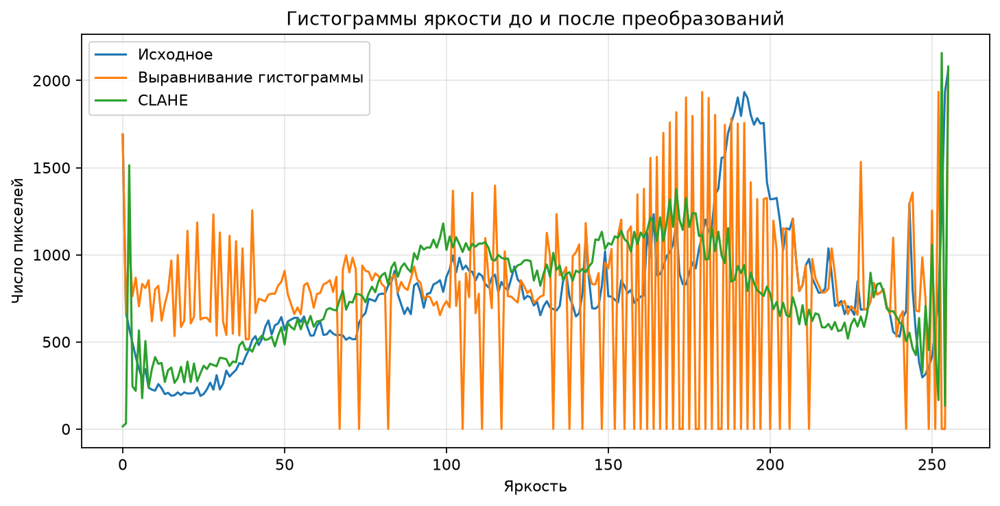
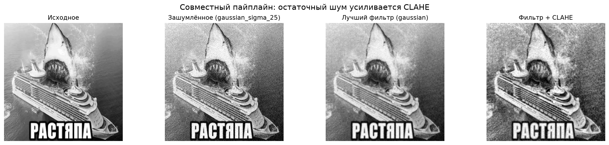
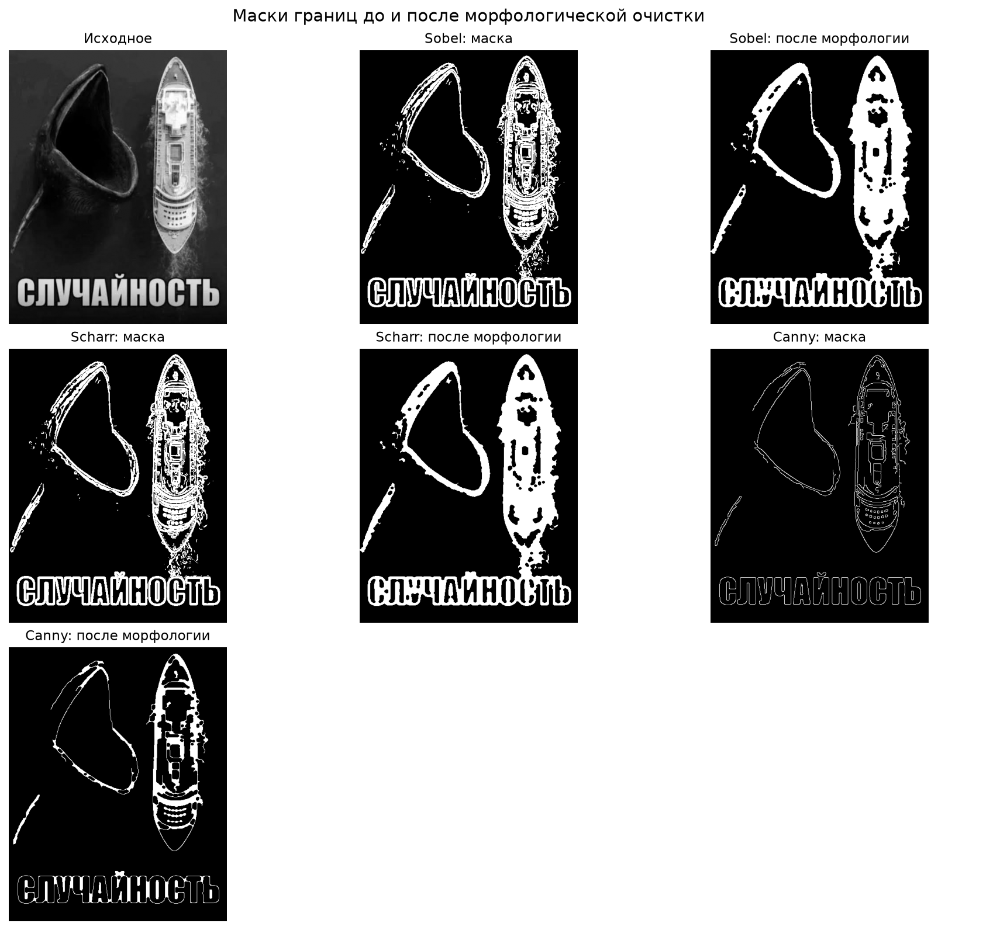
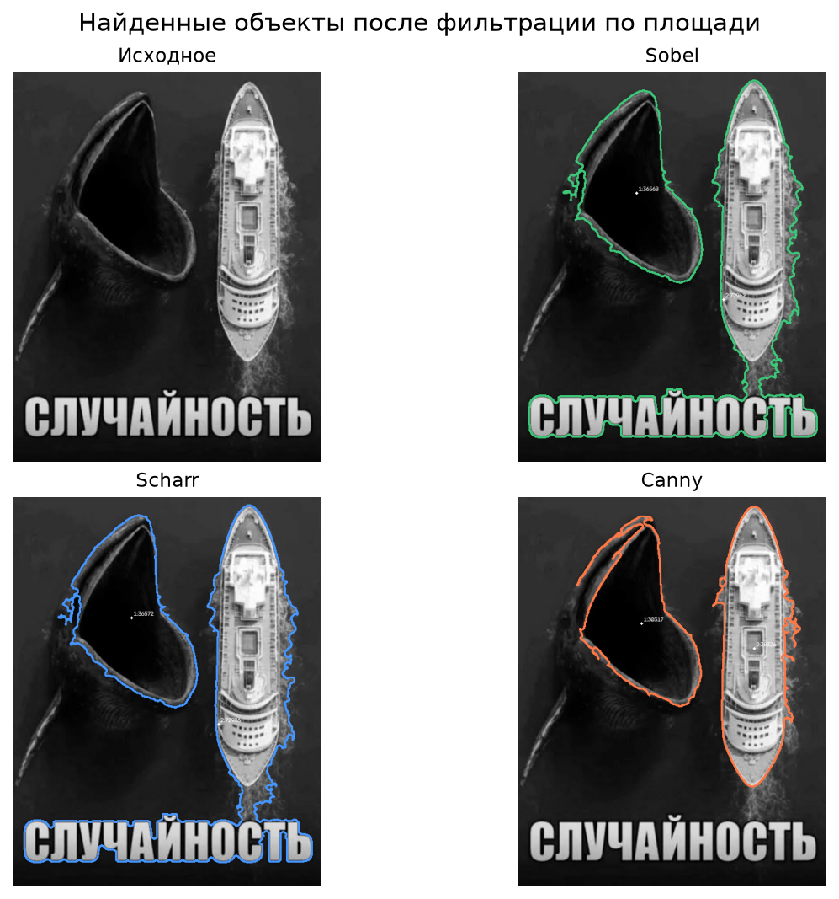
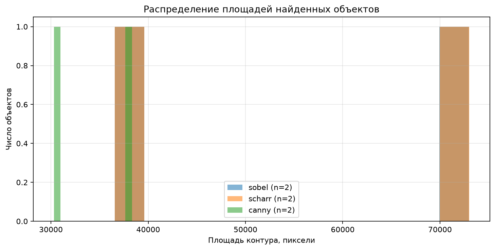
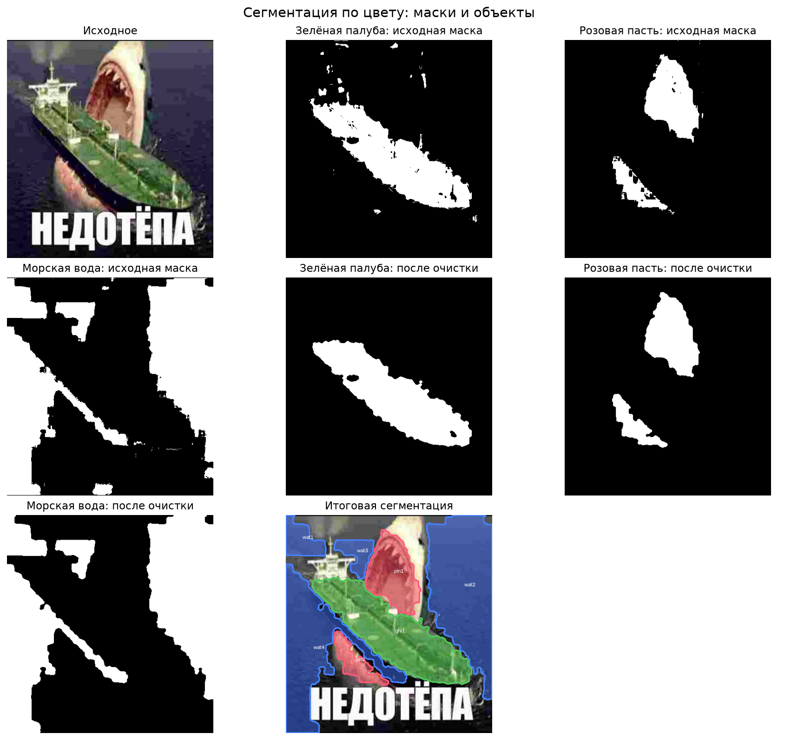
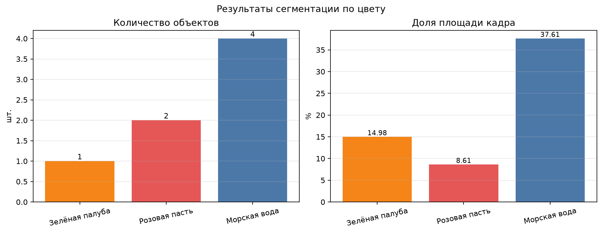

# Лабораторная работа №1. Базовый пайплайн обработки изображения

**Дата выполнения:** 6 ноября 2026 г.

## 1. Цель и задачи

Цель работы — освоить базовый пайплайн обработки изображения и научиться
обосновывать выбор метода и его параметров. В работе реализованы все три
варианта задания:

1. шумоподавление и повышение контраста;
2. выделение границ и контуров объектов;
3. сегментация изображения по цвету.

Для каждого варианта параметры вынесены в JSON-конфиг, программа запускается
из командной строки, а результаты сохраняются в виде изображений «до/после»,
масок, графиков и CSV-таблиц с количественными метриками. В отличие от
демонстрационного запуска на встроенных изображениях scikit-image, в этой
работе используются пользовательские изображения из папки `data/`.

## 2. Инструменты и данные

Использованы Python 3.14, NumPy, OpenCV, Pillow, scikit-image и matplotlib.
Все изображения находятся в `data/` и загружаются по именам из конфига
`configs/default.json`. Для вариантов 1 и 2 цветные JPEG-файлы переводятся в
полутоновой вид, для варианта 3 используется RGB.

| Вариант | Файл | Размер (высота × ширина) | Тип | Содержание |
|---|---|---|---|---|
| 1 | `data/images.jpg` | 446 × 448 | полутоновое после загрузки | корабль и акула, крупная подпись |
| 2 | `data/images2.jpg` | 621 × 494 | полутоновое после загрузки | кит и корабль, крупная подпись |
| 3 | `data/images3.jpg` | 459 × 435 | цветное RGB | корабль в пасти акулы, подпись |

Изображения представляют собой мемы с крупными объектами и текстом. Это
важно для интерпретации результатов: подпись создаёт сильные перепады
яркости, а JPEG-сжатие добавляет высокочастотные артефакты. Поэтому пороги
для вариантов 2 и 3 подбирались не «на глаз», а по распределению градиентов
и HSV-компонент конкретной сцены.

## 3. Воспроизводимость

Единая точка входа:

```bash
.venv/bin/python -m src all --config configs/default.json --out out
```

Отдельные варианты запускаются командами `python -m src 1`, `python -m src 2`
и `python -m src 3`. Любой параметр конфига можно переопределить без правки
кода:

```bash
python -m src 1 --set variant1.gaussian_sigma=1.2 \
                --set variant1.clahe_clip_limit=2.0
```

Для синтетического шума используется фиксированное зерно генератора, что
делает графики и таблицы воспроизводимыми. Все численные результаты
дублируются в CSV-файлах в папках `out/variant1`–`out/variant3`.

## 4. Вариант 1. Шумоподавление и контраст

### 4.1. Методика

К исходному полутоновому изображению `data/images.jpg` добавлялся
синтетический шум двух типов:

- аддитивный гауссов шум со СКО σ = 5, 10, 15, 20, 30 и 40 уровней яркости;
- импульсный шум «соль и перец» с долей повреждённых пикселей 1, 2, 5, 8 и 12 %.

Для каждого уровня выполнялось по три независимые реализации шума. Одна и та
же зашумлённая реализация обрабатывалась двумя фильтрами:

- гауссовым фильтром 5 × 5 с σ = 1.2;
- медианным фильтром 5 × 5.

Восстановление сравнивалось с чистым изображением по PSNR и SSIM
(`data_range = 255`). Результаты усреднялись по реализациям, на графиках
показана полоса ± одно стандартное отклонение.

### 4.2. Результаты по шуму



*Рис. 1. Зависимость PSNR/SSIM от уровня гауссова и импульсного шума.*

Выборочные значения:

| σ гауссова шума | Гауссов фильтр, PSNR | Гауссов фильтр, SSIM | Медианный фильтр, PSNR | Медианный фильтр, SSIM |
|---:|---:|---:|---:|---:|
| 10 | 25.25 | 0.829 | 24.18 | 0.759 |
| 20 | 24.73 | 0.760 | 23.68 | 0.688 |
| 30 | 24.01 | 0.684 | 23.04 | 0.611 |
| 40 | 23.18 | 0.616 | 22.37 | 0.542 |

| Доля импульсного шума | Гауссов фильтр, PSNR | Гауссов фильтр, SSIM | Медианный фильтр, PSNR | Медианный фильтр, SSIM |
|---:|---:|---:|---:|---:|
| 2 % | 24.74 | 0.766 | 24.34 | 0.794 |
| 5 % | 23.73 | 0.672 | 24.26 | 0.792 |
| 8 % | 22.77 | 0.599 | 24.13 | 0.790 |
| 12 % | 21.73 | 0.534 | 23.95 | 0.787 |

На гауссовом шуме гауссов фильтр устойчиво лучше: при σ = 40 он даёт
PSNR 23.18 дБ против 22.37 дБ и SSIM 0.616 против 0.542. Это ожидаемо:
линейное усреднение оптимально подавляет аддитивный нормальный шум.

На импульсном шуме картина зависит от засорённости. При 2 % выбросов
гауссов фильтр ещё немного выигрывает по PSNR (24.74 против 24.34 дБ), но
проигрывает по SSIM (0.766 против 0.794). Начиная с 5 % медианный фильтр
выходит вперёд по обоим показателям: при 12 % он даёт PSNR 23.95 дБ и
SSIM 0.787 против 21.73 дБ и 0.534 у гауссова фильтра. Медиана почти не
деградирует при росте доли выбросов, потому что отдельные экстремальные
пиксели не влияют на медиану так сильно, как на среднее.

PSNR получился ниже, чем на гладких тестовых изображениях: сцена содержит
мелкую текстуру воды, много контуров и крупную подпись. Даже небольшое
размытие заметно меняет такие высокочастотные детали, поэтому абсолютные
значения PSNR находятся в диапазоне примерно 21.7–25.4 дБ. Для сравнения
фильтров это не мешает: относительный порядок методов сохраняется.

### 4.3. Выбор параметров фильтров

Дополнительно выполнено сканирование параметров при фиксированном гауссовом
шуме σ = 25:



*Рис. 2. Чувствительность PSNR/SSIM к σ гауссова фильтра и размеру ядра
медианного фильтра.*

| Фильтр | Параметр | PSNR, дБ | SSIM |
|---|---|---|---:|
| Гауссов | σ = 0.8 | 25.61 | 0.690 |
| Гауссов | σ = 1.2 | 24.40 | 0.722 |
| Гауссов | σ = 1.4 | 23.94 | 0.719 |
| Гауссов | σ = 2.0 | 23.20 | 0.701 |
| Медианный | ядро 3 | 24.73 | 0.623 |
| Медианный | ядро 5 | 23.41 | 0.650 |
| Медианный | ядро 7 | 22.04 | 0.632 |
| Медианный | ядро 9 | 20.83 | 0.601 |

У гауссова фильтра PSNR максимален при малом σ = 0.8, но SSIM при этом всего
0.690: фильтр почти не подавляет шум и сохраняет высокочастотные детали
формально, но изображение остаётся шумным. Максимум SSIM достигается при
σ = 1.2 (0.722); при σ = 1.4 SSIM почти такой же (0.719), но PSNR ниже на
0.46 дБ. Поэтому в конфиге выбрано σ = 1.2: это лучший компромисс по
совокупности PSNR и SSIM.

Для медианного фильтра ядро 5 × 5 даёт лучший SSIM (0.650) при PSNR 23.41 дБ.
Ядро 3 × 3 сохраняет более высокий PSNR (24.73 дБ), но заметно хуже подавляет
импульсный шум и даёт SSIM 0.623. Ядра 7 и 9 снижают обе метрики из-за
чрезмерного сглаживания. Поэтому выбрано ядро 5 × 5.

### 4.4. Сравнение выравнивания гистограммы и CLAHE

Для исходного изображения сравнивались глобальное выравнивание гистограммы
(`cv2.equalizeHist`) и адаптивное выравнивание CLAHE (clip limit 2.0,
плитка 8 × 8). Поскольку оба метода меняют яркости пикселей, PSNR/SSIM
считались относительно исходного изображения; дополнительно оценивались
средняя яркость, глобальное СКО и энтропия.



*Рис. 3. Исходное изображение, глобальное выравнивание и CLAHE.*



*Рис. 4. Гистограммы яркости до и после преобразований.*

| Метод | PSNR к исходному | SSIM к исходному | Средняя яркость | СКО | Энтропия |
|---|---:|---:|---:|---:|---:|
| Без обработки | — | 1.000 | 146.99 | 65.96 | 7.841 |
| Выравнивание гистограммы | 20.51 | 0.919 | 127.03 | 74.38 | 7.659 |
| CLAHE | 21.21 | 0.881 | 137.78 | 64.29 | 7.882 |

Глобальное выравнивание увеличивает СКО (65.96 → 74.38), то есть формально
повышает глобальный контраст, но снижает энтропию (7.841 → 7.659). Причина —
дискретность гистограммы: часть уровней яркости после преобразования не
используется, гистограмма становится «гребенчатой», а светлые участки
уходят в пересвет. Средняя яркость при этом падает до 127.03.

CLAHE, наоборот, почти сохраняет глобальное СКО (64.29) и немного повышает
энтропию (7.882). Это не противоречие: CLAHE усиливает локальные перепады
в пределах плиток, а не растягивает весь диапазон глобально. Визуально он
действует мягче и не «выжигает» света, хотя SSIM у него ниже (0.881 против
0.919), потому что локальные преобразования сильнее меняют пиксели
относительно оригинала. PSNR и SSIM здесь нельзя использовать как
единственный критерий: они штрафуют любое изменение тона, даже если контраст
субъективно улучшился. Поэтому вывод делается по совокупности метрик и
визуального сравнения.

### 4.5. Совместный пайплайн и остаточный шум



*Рис. 5. Фильтрация зашумлённого изображения и последующее применение CLAHE.*

| Этап | PSNR к чистому | SSIM к чистому |
|---|---:|---:|
| Зашумлённое изображение (σ = 25) | 20.52 | 0.424 |
| Гауссов фильтр 5 × 5, σ = 1.2 | 24.40 | 0.723 |
| Гауссов фильтр + CLAHE | 19.00 | 0.571 |

После фильтрации остаётся шумовая составляющая, которую CLAHE усиливает
вместе с полезными локальными контрастами. В результате PSNR падает ниже
уровня зашумлённого изображения (19.00 против 20.52 дБ), а SSIM хотя и растёт,
но визуально картинка становится зернистой. Практический вывод: при заметном
шуме нельзя ставить CLAHE сразу после слабого фильтра; нужно либо сильнее
подавить шум, либо уменьшить clip limit, либо применять контрастирование до
добавления шума (если это возможно в реальном пайплайне).

### 4.6. Вывод по варианту 1

- Для гауссова шума выбирается гауссов фильтр, для импульсного — медианный;
  при малой доле импульсов (1–2 %) разница небольшая, а с 5 % медиана
  становится заметно устойчивее.
- Для гауссова фильтра 5 × 5 выбран σ = 1.2; для медианного — ядро 5 × 5.
- CLAHE предпочтительнее глобального выравнивания для естественных
  изображений: выше энтропия, мягче тональные изменения и меньше пересветов.
- PSNR/SSIM полезны для сравнения фильтров, но для оценки контрастных
  преобразований их нужно дополнять метриками контраста и визуальным анализом.
- Совместный пайплайн «фильтр → CLAHE» усиливает остаточный шум; это
  ограничение важно учитывать при выборе силы фильтра.

## 5. Вариант 2. Границы и контуры объектов

### 5.1. Методика

Использовалось изображение `data/images2.jpg` (621 × 494), содержащее
крупного кита слева, корабль справа и подпись внизу. Перед выделением границ
применялось гауссово размытие с σ = 1.0 для подавления мелкой текстуры воды
и JPEG-артефактов.

Сравнивались три метода:

- **Sobel** — модуль градиента, порог на уровне 82-го перцентиля (в маску
  попадают примерно 18 % самых сильных откликов);
- **Scharr** — аналогично, с более точными ядрами для поворотов;
- **Canny** — гистерезисный детектор с порогами 60/180.

Маски очищались морфологическим закрытием эллиптическим ядром 7 × 7
(одна итерация) и удалением связных компонент площадью менее 20 пикселей.
Затем искались внешние контуры (`RETR_EXTERNAL`), которые фильтровались по
площади: не менее 25 000 пикселей, верхнего ограничения нет. Такой порог
отсекает отдельные буквы подписи и мелкие детали, но сохраняет крупные
объекты сцены.

### 5.2. Результаты



*Рис. 6. Маски Sobel, Scharr и Canny до и после морфологической очистки.*



*Рис. 7. Контуры, прошедшие фильтрацию по площади.*



*Рис. 8. Распределение площадей найденных контуров.*

| Метод | Найдено объектов | Средняя площадь, px | Минимум, px | Максимум, px |
|---|---:|---:|---:|---:|
| Sobel | 2 | 54 765.0 | 36 568 | 72 962 |
| Scharr | 2 | 54 779.0 | 36 571.5 | 72 986.5 |
| Canny | 2 | 34 321.5 | 30 317 | 38 326 |

Все три метода нашли по два крупных объекта. Однако локализация у них
различается. Canny даёт тонкие, хорошо разделённые границы: контур кита
площадью 30 317 px (bbox 199 × 304) и контур корабля площадью 38 326 px
(bbox 140 × 448). Контур подписи имеет площадь около 21 864 px и отсекается
порогом 25 000 px.

Sobel и Scharr при выбранном пороге дают более толстый отклик. Контур кита
получается площадью около 36 570 px, а второй контур (около 73 000 px)
объединяет корабль, кильватерный след и подпись: между ними остаётся
непрерывная цепочка градиентов на текстуре воды. Формально это тоже два
объекта, но второй объект является не отдельным кораблём, а слитной
областью «корабль + след + подпись». Это важное методическое отличие:
порог по перцентилю и морфологическое закрытие не всегда разделяют
соприкасающиеся или связанные текстурой объекты.

Порог 82-го перцентиля выбран в ходе подбора. При более низком пороге
(75–80 %) контур кита замыкается, но фон и следы на воде добавляют всё
больше сильных откликов, и крупные области сливаются ещё сильнее. При
85 % и выше граница кита распадается на отдельные фрагменты, и объект
перестаёт проходить фильтр по площади. Значение 82 % — компромисс, при
котором кит остаётся единым контуром. Ядро 7 × 7 выбрано потому, что при
3 × 3 и 5 × 5 в маске остаётся больше разрывов и мелких компонент, а при
9 × 9 границы становятся слишком толстыми и сильнее сливаются с фоном.

### 5.3. Вывод по варианту 2

- Canny лучше подходит для поиска отдельных объектов на сложном фоне:
  тонкие границы дают раздельные контуры кита и корабля.
- Sobel и Scharr чувствительнее к слабым перепадам, но на текстурированной
  воде и при наличии подписи склонны объединять объекты в одну область.
- Фильтрация по площади — эффективный способ убрать текст и мелкий шум;
  результат зависит от порога и размера морфологического ядра.
- Для сцен с крупными объектами и подписями предпочтительнее Canny, а
  Sobel/Scharr требуют дополнительной обработки или более сложной
  сегментации областей.

## 6. Вариант 3. Сегментация по цвету

### 6.1. Методика

Изображение `data/images3.jpg` (459 × 435) переводилось из RGB в HSV. В HSV
цвет (тон) отделён от яркости, что делает пороги устойчивее к освещению.
Заданы три класса:

| Класс | H (OpenCV, 0–179) | S | V | Мин. площадь |
|---|---|---:|---:|---:|
| Зелёная палуба | 30–65 | 50–255 | 40–255 | 3000 |
| Розовая пасть | 0–15 и 170–179 | 60–255 | 50–255 | 2000 |
| Морская вода | 100–140 | 40–255 | 15–220 | 3000 |

Диапазоны подобраны по распределению HSV: зелёная палуба имеет H ≈ 36–49,
розовые участки пасти — H около 0–10 и высокую насыщенность, вода — H ≈ 118–127.
Белая подпись имеет низкую насыщенность (S < 40) и высокую яркость, поэтому
она не попадает ни в один цветовой класс и остаётся неразмеченной. Классы
сделаны взаимоисключающими: при пересечении приоритет имеет класс, указанный
в конфиге раньше (зелёный → розовый → вода).

Маски очищались морфологическим закрытием и открытием эллиптическим ядром
7 × 7, затем удалялись связные компоненты площадью менее 25 пикселей.
Объекты и их площади вычислялись через `skimage.measure.regionprops`;
дополнительно фильтровались объекты меньше минимальной площади класса.
Ядро 7 × 7 выбрано как компромисс: при 5 × 5 остаётся больше мелких
артефактов, а при 9 × 9 маски сильнее утолщаются и могут сливать близкие
фрагменты. При 5 × 5 и 9 × 9 состав классов сохраняется, но 7 × 7 даёт
умеренное сглаживание границ.

### 6.2. Результаты



*Рис. 9. Исходное изображение, маски классов до/после очистки и итоговая
разметка.*



*Рис. 10. Количество объектов и доля площади кадра по классам.*

| Класс | Объектов | Суммарная площадь, px | Доля кадра | Средняя площадь, px |
|---|---:|---:|---:|---:|
| Зелёная палуба | 1 | 29 905 | 14.98 % | 29 905.0 |
| Розовая пасть | 2 | 17 199 | 8.61 % | 8 599.5 |
| Морская вода | 4 | 75 089 | 37.61 % | 18 772.25 |
| **Итого** | **7** | **122 193** | **61.20 %** | — |

Зелёная палуба образует одну связную область площадью 29 905 px с
компактностью (solidity) 0.865. Розовая пасть распадается на две области:
верхнюю (12 733 px, bbox 117 × 180) и нижнюю (4 466 px, bbox 117 × 114).
Это не ошибка сегментации, а следствие геометрии сцены: верхняя и нижняя
челюсти разделены кораблём и зубами, поэтому `regionprops` видит две
связные компоненты.

Морская вода даёт четыре области: 37 846, 28 720, 4 776 и 3 747 px. Крупные
области соответствуют воде над и под кораблём, меньшие — участкам между
акулой, кораблём и границей кадра. Суммарно вода занимает 37.61 % кадра и
доминирует в сегментации. Белая подпись «НЕДОТЁПА» не входит в цветовые
классы: у неё низкая насыщенность, поэтому она остаётся чёрной на итоговом
оверлее.

Общая доля размеченных пикселей — 61.20 %. Оставшаяся часть приходится на
белую подпись, серые блики, тени и переходные пиксели на границах объектов,
которые не попали в заданные HSV-диапазоны.

### 6.3. Вывод по варианту 3

- HSV-пороги позволяют надёжно выделить три цветовых класса на изображении
  `images3.jpg`: зелёную палубу, розовую пасть и синюю воду.
- Морфологическая очистка и фильтрация по площади убирают шум, но могут
  дробить объекты со сложной геометрией: пасть представлена двумя
  компонентами, вода — четырьмя.
- `regionprops` даёт площадь, периметр, центроид, bbox и компактность;
  эти данные сохранены в `out/variant3/regions.csv`.
- Белый текст и серые блики не относятся к цветовым классам и остаются
  неразмеченными; это ожидаемое ограничение выбранной схемы.
- Пороги подобраны для конкретной сцены; для произвольных фотографий
  требуется калибровка или интерактивный подбор.

## 7. Общие выводы

1. Выбор метода определяется типом искажения или объекта, а не
   универсальным «лучшим» алгоритмом: гауссов фильтр лучше для гауссова шума,
   медианный — для импульсного; Canny удобнее для контуров, Sobel/Scharr —
   для анализа градиентов.
2. Параметры нужно подбирать количественно. Сканирование σ и размера ядра
   показало компромисс между подавлением шума и сохранением деталей;
   для варианта 2 порог перцентиля определяет, замкнётся ли контур кита;
   для варианта 3 HSV-диапазоны отделяют палубу и пасть от воды.
3. PSNR и SSIM полезны для сравнения восстановления с эталоном, но плохо
   подходят как единственный критерий повышения контраста: любое тональное
   преобразование снижает эти метрики. Для контраста нужны энтропия,
   локальный контраст и визуальная оценка.
4. Морфология — мощный, но не нейтральный инструмент: она закрывает разрывы
   и удаляет шум, однако может объединять или дробить объекты. Это хорошо
   видно на варианте 2, где Sobel/Scharr объединяют корабль, след и подпись,
   и на варианте 3, где пасть и вода распадаются на несколько компонент.
5. Все результаты воспроизводимы: параметры вынесены в конфиг, зерно
   генератора шума фиксировано, CLI и README содержат команды запуска,
   а исходные изображения лежат в `data/`.

## 8. Ограничения

- Синтетический шум не полностью моделирует реальные сенсорные искажения
  (коррелированный шум, артефакты сжатия, неравномерное освещение).
- Исходные изображения — мемы с JPEG-сжатием, крупным текстом и небольшим
  разрешением; это добавляет высокочастотные артефакты и влияет на
  абсолютные значения PSNR/SSIM.
- Пороги Sobel/Scharr/Canny и HSV подобраны для конкретных тестовых
  изображений; на других сценах их нужно адаптировать.
- PSNR и SSIM чувствительны к сдвигам и тональным изменениям; для оценки
  субъективного качества контраста использовались дополнительные метрики.
- `regionprops` считает связные компоненты, поэтому текстурированные объекты
  могут распадаться на несколько областей.

<div style="page-break-before: always;"></div>

## 9. Приложение. Команды и файлы

```bash
# установка
python3 -m venv .venv
source .venv/bin/activate
pip install -r requirements.txt

# все варианты
python -m src all

# переопределение параметров
python -m src 2 --set variant2.sobel_percentile=82 \
                --set variant2.min_area=25000
python -m src 3 --set variant3.morph_kernel=7

# сборка PDF
pip install -r requirements-report.txt
python scripts/build_report.py
```

Основные результаты: `out/variant1`, `out/variant2`, `out/variant3`.
Полные таблицы метрик — в CSV-файлах соответствующих папок, сводки — в
`summary.json`. Исходный код разделён на общие утилиты (`src/common.py`) и
модули вариантов (`src/variant1.py`, `src/variant2.py`, `src/variant3.py`).
